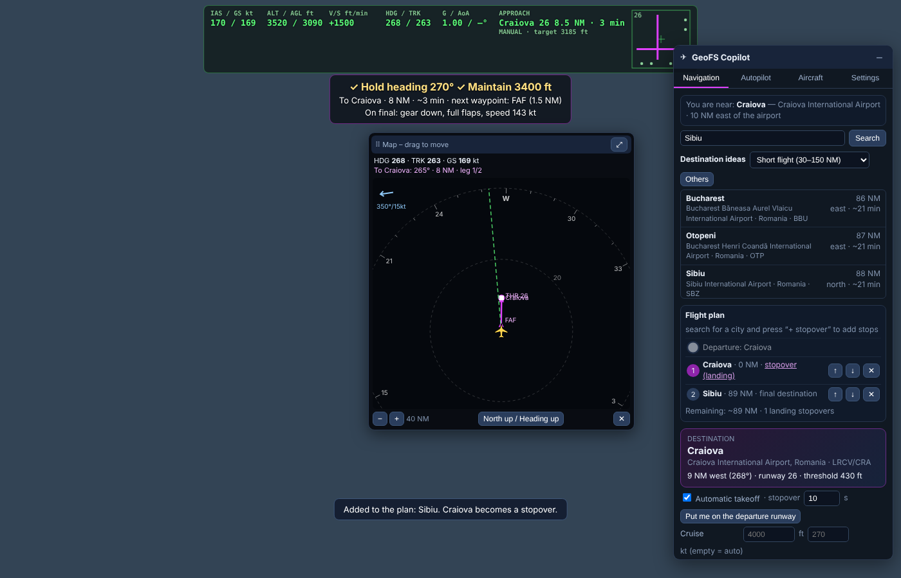
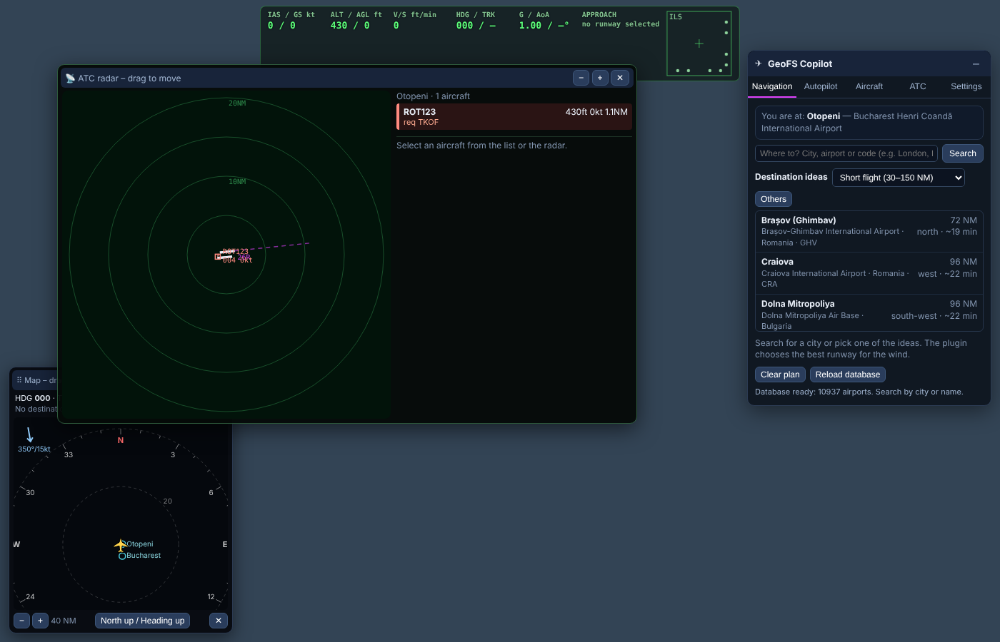

# ✈ GeoFS Copilot

**A copilot for [GeoFS](https://www.geo-fs.com), the free browser flight simulator.**
Type a city name and the plugin flies the whole trip: automatic takeoff, climb, cruise, descent, an ILS-style approach and landing. It also handles stopovers.

*Created by **Razvan Cristea**.* · 🌐 **[Website & leaderboard](https://razvan999x.github.io/geofs-copilot/)** · 🇷🇴 [Versiunea în română mai jos](#-în-română)



## Features

- **Destination by name.** Search for "London", "Paris", "Munich" or an airport code. You can also pick from destination ideas (short, medium or long flights).
- **Full flight on one button.** The plugin takes off automatically, climbs to a cruise altitude chosen for the distance, flies the route and starts the descent at the right time. It then lines up with the runway and lands.
- **Stopovers.** Add as many stops as you like. Each one is either a landing stopover (land, wait, take off again) or a fly-over.
- **Moving map** with a heading-up or north-up view. It shows the route, nearby airports by city name and the wind. You can drag and resize it.
- **Step-by-step instructions**, for example "Turn RIGHT 30° → heading 285°" or "Descend to 3000 ft". These work for manual flying too.
- **3D approach corridor** drawn in the sky, plus an ILS-style localizer and glideslope indicator.
- **The plugin picks the runway for the wind** (headwind first) and shows head- and crosswind components.
- **Landing assistant**: voice callouts (1000, 500, 100… ft), GPWS-style warnings (SINK RATE, GLIDESLOPE, GEAR, TERRAIN…) and a **landing score** from 0 to 100.
- **Extended autopilot**: altitude, heading, speed, vertical speed and max bank, with keyboard shortcuts.
- **Aircraft systems panel**: engines, gear, flaps, spoilers, brakes, trim, reverse thrust and **individual throttle per engine**.
- **Missions and fuel.** Accept paid jobs at the airport you are at: passengers, cargo, fragile cargo, urgent medical or VIP flights, each with a deadline. Bonuses for smooth landings and on-time arrival, penalties for hard landings or delays. Fuel is simulated: capacity and burn come from the aircraft's mass and engine power, you refuel on the ground and pay for it from your earnings, and **if the tank runs dry the engines stop in flight**.
- **Daily challenge and streaks.** Every day there is one tricky airport for everyone (Innsbruck, Gibraltar, Madeira, Lukla…). *Fly it now* puts you on final; your best score goes on the daily leaderboard. Fly on consecutive days to build a streak: up to +70 XP a day.
- **Weekly landing contest.** Your best landing of the week is ranked automatically. The top 3 get the Podium badge.
- **Special missions.** Bush flights to short strips, sightseeing tours over famous landmarks, skydiver drops, aerial survey photos at an exact altitude, and search & rescue with a signal that grows as you get closer.
- **Airport passport.** Every airport and country you land at is stamped, with flags in the plugin and a map on your profile.
- **Your own airline.** Found an airline at your hub, buy aircraft and give them routes you have flown yourself. They earn money even when you are offline, for up to 24 hours, so come back daily to collect. Good landings raise your reputation, and reputation raises income.
- **Career.** Earn XP from flights, missions, lessons and achievements. Rise through 7 ranks, from Student Pilot to Chief Pilot. Higher ranks unlock bigger aircraft for missions and pay more. You can also buy a type rating early.
- **Emergencies.** Random failures, if you turn them on: engine failure, jammed gear, bird strike, fuel leak, a medical emergency on board, autopilot failure. Each comes with a checklist, a divert-to-nearest-airport button and MAYDAY.
- **Flight school.** Guided lessons: first takeoff, straight & level and turns, approach and landing, engine failure after takeoff, precision landing. Plus 15 achievements.
- **Logbook.** Every flight is saved with its path. Export it to Google Earth (KML), GPX or CSV.
- **Online leaderboard.** Your flights are published to the [GeoFS Copilot website](https://razvan999x.github.io/geofs-copilot/), with pilot profiles, best landings and global stats. You can turn this off.
- **See other Copilot users.** All multiplayer traffic is drawn on the map, and other GeoFS Copilot users are marked with a gold ★. The panel header shows how many Copilot users are online.
- **English and Romanian**, switchable in Settings.
- **Air traffic control (ATC).** A player can act as tower controller for any airport, with a radar, traffic strips and clearances. Pilots using the plugin get every instruction as an *Accept / Unable* card, and the autopilot carries it out. When no human controller is online, a virtual tower clears takeoffs and landings only when the runway and final are free.

## Installation

You can load the plugin in three ways. The first one always works.

### 1. Bookmark (recommended, works everywhere)

1. Create a new bookmark in your browser (right-click the bookmarks bar → *Add page…*).
2. Name: `GeoFS Copilot`. URL: paste this line:

   ```
   javascript:(function(){var s=document.createElement('script');s.src='https://cdn.jsdelivr.net/gh/razvan999x/geofs-copilot@main/geofs-copilot.user.js';document.body.appendChild(s);})();
   ```

3. Open GeoFS, wait for the aircraft to load, then click the bookmark. A purple "GeoFS Copilot" label appears at the bottom right.

### 2. Tampermonkey (loads automatically)

1. Install [Tampermonkey](https://www.tampermonkey.net/).
2. Open [geofs-copilot.user.js](https://github.com/razvan999x/geofs-copilot/raw/main/geofs-copilot.user.js). Tampermonkey offers to install it.
3. In Chrome 138 or newer, go to `chrome://extensions` → Tampermonkey → *Details* and enable **Allow User Scripts**.

### 3. Console (quick test)

Open GeoFS and press **F12** → *Console*. Paste the whole content of `geofs-copilot.user.js` and press Enter.

## How to fly

1. Press **Shift+N** to open the panel and type a city in **Navigation**. Click a result.
2. Optional: search for more cities and press **+ stopover** to build a multi-stop plan.
3. Press **✈ Full flight** (or **Shift+P**). If you are not on a runway, the plugin moves you to the start of the best one, since taxiing is not automated.
4. Sit back. To land yourself, untick *Automatic landing* in Settings. The autopilot then disconnects at 200 ft.

## Missions and fuel

Open the **Missions** tab in the panel.

- **Fuel.** The gauge shows fuel on board, current flow, endurance and the fuel needed for your planned route plus a 30-minute reserve (white mark). Refuel only on the ground, stopped, at an airport: *Fill up*, *Enough for the route* or *+25%*. Fuel costs $0.35/kg. If you run out in flight, the engines stop and will not restart. You can turn fuel simulation off or change the burn rate (×0.5 to ×3).
- **Missions.** On the ground at an airport you get offers to destinations your aircraft can reach, with cargo or passengers, distance, deadline and pay. Accept one and the destination is set automatically. Wait for boarding, then fly (Full flight works). Land and stop at the destination to get paid.
- **Pay.** +15% for an excellent landing, +10% for medical/VIP flights on time. −30% for a hard landing (−60% with fragile cargo), −10% if passengers were scared by steep banks, and a deadline penalty when late. Cancelling a mission costs 20% of its pay.
- **Special missions** appear next to the regular ones:
  - 🛩️ **Bush flight** (light aircraft): a short strip under 2,700 ft. A precise landing pays +20%.
  - 📸 **Sightseeing tour**: overfly 1–3 landmarks near you (Eiffel Tower, Peleș Castle, Golden Gate…) below the given height, then land back. A smooth flight pays +10%.
  - 🪂 **Skydivers** (light to regional aircraft): climb over the airport to the jump altitude, slow down, release them, then land.
  - 🗺️ **Aerial survey**: three photo points in a line at an exact altitude. Perfect photos pay +25%, blurry ones cost 15% each.
  - 🔎 **Search & rescue**: fly to the search zone and search low. The signal bars grow as you get closer. Once you find the survivor, land at any airport.
  - The points appear on the 3D map and the moving map. The instruction box shows distance, bearing and the altitude target. *AP → point* makes the autopilot steer to the next point.
- Your balance, missions, flight hours and distance are saved in your browser. Everyone starts with $10,000.

## Daily challenge, streaks, landing contest and passport

- **Daily challenge** (top of the Missions tab): one airport for everyone, changing at midnight UTC. Press *Fly it now* to start on final, or fly there any way you like. Every landing there counts, and your best score is kept. You can retry as often as you like. First completion of the day: +30 XP plus a bonus for the score.
- **Streak:** your first flight of each day (UTC) gives +10 XP per day in a row, up to +70. Miss a day and it restarts.
- **Weekly landing contest** (Career tab and the website): every pilot's best landing of the week, Monday to Sunday UTC. The runway must be identified.
- **Passport** (Career tab): airports and countries you have landed at. Your profile on the website shows them on a map.

## Airline

Open the **Airline** tab. You need the Commercial Pilot rank and $25,000, and you must be on the ground at the airport that will be your hub.

- **Buy aircraft** of any class you are licensed for. Each class has its own price and range.
- **Routes** unlock when you fly from your hub to another airport (or back) yourself. Give each aircraft a route within its range.
- **Income** builds up every hour and is kept for up to 24 hours. Press *Collect* to move it to your balance. Aircraft without a route cost maintenance.
- **Reputation** goes up with good mission landings and down with failed or cancelled missions. It raises or lowers income. Missions to or from your hub pay +10%.
- Your airline is saved with your cloud progress and listed on the website.

## Career, school, logbook and online leaderboard

- **Career** tab: your rank and XP, type ratings (which aircraft classes you may fly on missions), achievements and the top 10 online.
- **Training** tab: five guided lessons. Each one sets you up on the runway or on final, and the steps appear in the instruction box. You can also trigger a failure on purpose to practise.
- **Logbook** tab: every flight, with distance, time, fuel, landing and pay. Export KML (Google Earth), GPX or CSV.
- **Website:** https://razvan999x.github.io/geofs-copilot/ has the daily challenge, the weekly landing contest, airlines, the all-time leaderboard (by XP, earnings, hours, missions, butter landings, distance, countries or streak), the best landings of the last 30 days, recent flights and pilot profiles.
- **Several computers:** in the Career tab, copy your *pilot code* and paste it on your other computer. The two profiles merge into one, with all flights, and your money, rank, type ratings, achievements and lessons stay in sync through the cloud. If you play on a new computer with the same GeoFS account, the plugin notices and offers to merge. The code is secret, like a password.
- **Privacy:** only your GeoFS callsign and your flight statistics are published. Each browser gets a random secret key, so nobody else can post in your name. The server checks every flight for plausibility and computes XP itself. To stop publishing, untick *Publish my flights* in Settings.

## Air traffic control (ATC)

ATC messages travel through the **GeoFS chat**, so both the controller and the pilots must be **signed in to GeoFS**. Each chat message is limited to 70 characters.



**Being a controller**

1. Open the panel (**Shift+N**) → **ATC** tab → Role: *Air traffic controller*.
2. Type the airport (city or ICAO code), press **Open tower** and choose the active runway. Pilots with the plugin see your tower automatically through the hidden signal, so there is no chat spam. A single "Tower online" message is posted when you open the tower, and you can switch even that off.
3. The radar shows every aircraft around, including pilots without the plugin and GeoFS AI traffic, labelled with callsign, altitude and speed. Pilot requests (takeoff/landing) are highlighted in red.
4. Select an aircraft on the radar or in the list and send an instruction: **Line up**, **Takeoff**, **Landing**, **Go around**, **Hold**, **Resume nav**, sequence number, **heading / altitude / speed**, or free text.

**Flying under ATC (pilot)**

- With **Full flight**, the plugin requests departure from the controller and waits. On *line up* it moves to the runway, and on *cleared takeoff* it takes off automatically.
- Approaching the destination it requests landing. Without a landing clearance it goes around at 500 ft.
- Every instruction appears as a card: **Accept (Shift+Y)** carries it out through the autopilot and replies "wilco"; **Unable (Shift+U)** declines.

**Virtual tower:** when no human controller is online, the plugin checks the runway and the final approach itself, using the traffic positions GeoFS shares. It holds on the ground until the runway is free, and goes around if the runway is occupied.

**Message format** (readable by everyone, parsed by the plugin): `@CALLSIGN text #CODE [arg]`. For example: `@ROT123 cleared takeoff 26R wind 350/15 #TO 26R`.
Codes: `TO LU LD GA HOLD RES HDG ALT SPD SEQ MSG` (controller), `RQTO RQLD WILCO UNABLE` (pilot), `ATC ATCOFF` (tower online/offline).

## Keyboard shortcuts

| Key | Action |
|---|---|
| Shift+P | full flight / stop / leave a stopover now |
| Shift+N | show/hide the panel |
| Shift+M | show/hide the map |
| Shift+H | show/hide the HUD |
| Shift+L | approach only (when already airborne) |
| Shift+R | teleport to final |
| Shift+A | engage AP and hold current values |
| Shift+↑ / ↓ | AP altitude ±1000 ft |
| Shift+← / → | AP heading ±5° |
| Shift+PgUp / PgDn | AP speed ±10 kt |
| Shift+G / F / S / E | gear / flaps / spoilers / engines |
| Shift+C | next camera |
| Shift+X | show last landing score |
| Shift+Y / U | ATC: accept / unable |

## Notes

- Airport and runway data come from [OurAirports](https://ourairports.com/data/) (public domain). They download once (~15 MB) and are cached in your browser.
- Some GeoFS aircraft have no autopilot. On those, follow the on-screen instructions and the map manually.
- This is an unofficial fan project. It is not affiliated with GeoFS.

## License

[MIT](LICENSE) © 2026 Razvan Cristea

---

## 🇷🇴 În română

**Un copilot pentru GeoFS, simulatorul de zbor gratuit din browser.** Scrii numele unui oraș, iar pluginul face tot zborul: decolare automată, urcare, croazieră, coborâre, apropiere ca un ILS și aterizare. Știe și escale.

*Creat de **Razvan Cristea**.*

**Instalare.** Cel mai simplu e semnul de carte (*bookmark*) de mai sus:
1. Creezi un semn de carte nou cu linia `javascript:…` ca adresă.
2. Deschizi GeoFS și aștepți să se încarce avionul.
3. Apeși pe semnul de carte.

Merge și cu Tampermonkey sau lipind codul în Console (F12).

**Utilizare:**
1. **Shift+N** deschide panoul. În *Navigation* scrii orașul și alegi rezultatul.
2. Cu **+ stopover** adaugi escale.
3. **✈ Full flight** (Shift+P) pornește zborul.

**Carieră, școală, jurnal și clasament:** câștigi XP și urci în grad (7 ranguri), primești urgențe aleatorii cu liste de verificare, faci lecții ghidate în tab-ul *Training*, iar zborurile se salvează în *Logbook* (export Google Earth). Clasamentul online e pe [site-ul GeoFS Copilot](https://razvan999x.github.io/geofs-copilot/).

**Misiuni și combustibil:** în tab-ul **Missions** accepți misiuni plătite (pasageri, marfă, transport medical, VIP), alimentezi la sol și vezi cât combustibil îți trebuie pentru traseu. Dacă rămâi fără combustibil în zbor, motoarele se opresc.

**Provocarea zilei, serii, concurs, pașaport:** în fiecare zi există un aeroport dificil, același pentru toți. Butonul *Zboară acum* te pune pe finală, iar cel mai bun scor intră în clasamentul zilei. Dacă zbori zile la rând, primești bonus XP (până la +70 pe zi). Cea mai bună aterizare a săptămânii intră automat în concursul de aterizare. Pașaportul adună aeroporturile și țările vizitate.

**Misiuni speciale:** zboruri bush pe piste scurte, tururi turistice peste obiective celebre (Peleș, Bran, Turnul Eiffel…), parașutiști, fotografie aeriană la altitudine exactă și căutare-salvare.

**Compania ta aeriană:** în tab-ul *Airline* (Companie) înființezi o companie la hub-ul tău, cumperi avioane și le dai rute pe care le-ai zburat tu. Câștigă bani și când nu joci, până la 24 de ore, așa că revii zilnic să încasezi.

Limba se schimbă în **Settings → Language / Limba**.

**Controlor de trafic (ATC):** în tab-ul **ATC** alegi rolul *Air traffic controller*, scrii aeroportul și apeși **Open tower**. Pe hartă vezi tot traficul din jur, iar ceilalți utilizatori ai pluginului sunt marcați cu ★ auriu. În bara de sus a panoului apare câți utilizatori Copilot sunt online. Pe radar vezi tot traficul, selectezi un avion și îi trimiți instrucțiuni (aliniere, decolare, aterizare, ratare, așteptare, cap/altitudine/viteză). Pilotul cu plugin primește un card **Accept / Refuz**, iar la accept autopilotul execută instrucțiunea. Fără controlor om, un turn virtual autorizează decolările și aterizările doar când pista e liberă. Mesajele trec prin chatul GeoFS, deci trebuie să fii logat în GeoFS.

